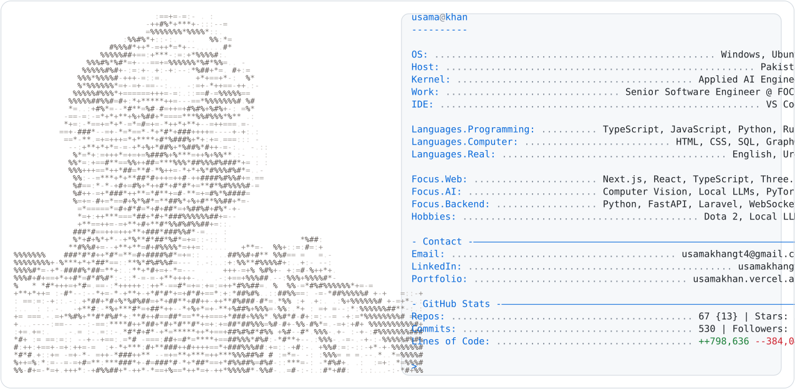
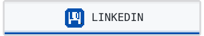
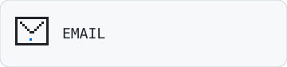

<a href="https://usamakhan.vercel.app/">
  <picture>
    <source media="(prefers-color-scheme: dark)" srcset="https://raw.githubusercontent.com/usamakhangt4/usamakhangt4/master/dark_mode.svg">
    
  </picture>
</a>

Applied AI Engineer | Full-Stack JavaScript & Python | Computer Vision, Local LLMs, & Modern Web Architecture

<a href="https://usamakhan.vercel.app/"><picture><source media="(prefers-color-scheme: dark)" srcset="https://raw.githubusercontent.com/usamakhangt4/usamakhangt4/master/link_portfolio_dark.svg"></picture></a><a href="https://www.linkedin.com/in/usamakhangt4/"><picture><source media="(prefers-color-scheme: dark)" srcset="https://raw.githubusercontent.com/usamakhangt4/usamakhangt4/master/link_linkedin_dark.svg"></picture></a><a href="mailto:usamakhangt4@gmail.com"><picture><source media="(prefers-color-scheme: dark)" srcset="https://raw.githubusercontent.com/usamakhangt4/usamakhangt4/master/link_email_dark.svg"></picture></a>

<picture>
  <source media="(prefers-color-scheme: dark)" srcset="https://raw.githubusercontent.com/usamakhangt4/usamakhangt4/master/pacman_dark.svg">
  
</picture>

## Featured

- **[KittenTTS WebUI](https://github.com/usamakhangt4/kitten-tts-webui)**: local text-to-speech web UI ([Samples](https://usamakhangt4.github.io/kitten-tts-webui/))
- **[git-auto-commit](https://github.com/usamakhangt4/git-auto-commit)**: Rust CLI that writes commit messages with a local Ollama model
- **[shadcn-virtualized-tree](https://github.com/usamakhangt4/shadcn-virtualized-tree)**: typed headless + virtualized React tree for large hierarchies
- **[viewer-360](https://github.com/usamakhangt4/viewer-360)**: framework-agnostic 360° product viewer Web Component with React/Vue/Angular wrappers (npm `@usamakhangt4/viewer-360`)
- **[YOLOPv2-Studio](https://github.com/usamakhangt4/YOLOPv2-Studio)**: real-time driving-perception studio (object, lane, drivable area) with CUDA/MPS
- **[Corpo Braindance](https://corpo-braindance.vercel.app/)**: local-first cyberpunk corporate-brief generator (Next.js 16, React 19, Zustand, static export, no backend)
